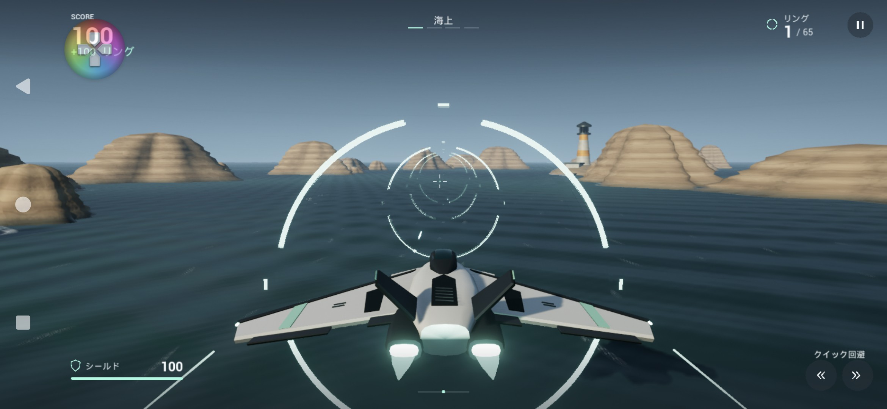
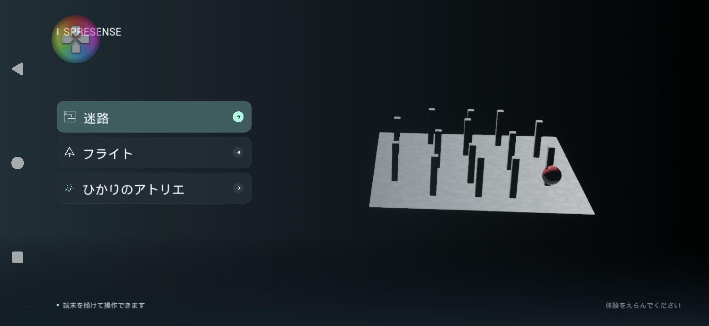

# フライトの警告とタイトルの配置の修正

2026-11-06、Xperia 1 VII（Android 16）で確認しました。

## フライトの赤いメッセージ

表示されていたのは、AndroidでSkyAtmosphereを描くための空のメッシュが不足している警告でした。UE付属のIsSky対応マテリアルと空の球体をプロジェクト内へ複製し、フライトの環境へ追加しました。警告表示を一括で無効にする設定は加えていません。空の球体には衝突・影がなく、ひかりのアトリエの粒子表現にも影響しません。

[EpicのSky Atmosphere資料](https://dev.epicgames.com/documentation/en-us/unreal-engine/sky-atmosphere-component-in-unreal-engine)にあるスカイドームの方式です。追加資産は既存の`/Game/Flight`のパッケージ対象に含まれます。

実機で開始前とプレイ中に赤字がないことを確認しました。プレイ中にリングを通過して100点が加算されることも確認しています。

## 迷路のプレビュー

選択時の迷路がメニューの裏にあったため、初期位置と毎フレームの位置をフライト・ひかりのアトリエと同じ右側へそろえました。大きさも見やすく調整しています。実機で迷路を選択し、メニューと重ならないことを確認しました。

## 認証キー

接続設定の未設定時の入力欄を「Termuxに表示された認証キー」に変更しました。キーはGitHubの認証情報ではなく、端末内OpenClaw Gatewayのものです。再表示方法は[初回セットアップの手順4](SetupAndDevelopment.md#4-端末内の演出サービスを起動する)へ追記しました。

今回はAIへの生成依頼は行っていません。Android版のビルド・インストールと上記の実機確認を行い、自動テスト一式は再実行していません。
