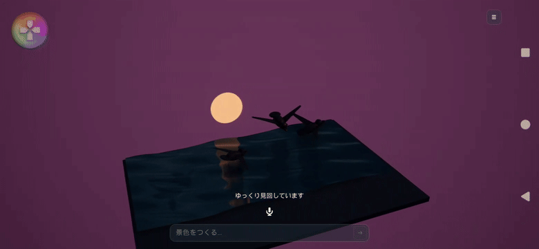

# カメラ回転と従来アニメーションの確認

Xperia 1 VII（XQ-FS54／Android 16）、2340×1080の横画面、Android ASTC Developmentで確認しました。端末内TermuxのOpenClawからCopilot `gpt-6-luna`を使用しています。

## 追加した操作

- 景色の中央をドラッグして360度見回す。上下は10〜85度の範囲で見下ろす角度を変更。
- 2本指のピンチで拡大縮小。ドラッグ中に端末の傾き入力を上書きしません。
- ハンバーガーメニューの「自動回転」で毎秒12度の回転を開始／停止。「視点を戻す」で初期の向きと倍率へ戻す。
- AIの`camera.orbit`でも毎秒−30〜30度の回転を指定可能。カメラだけの変更では、飛行・群れ・粒子の集合を最初から再開しません。

カメラは動いている景色の範囲を収めるよう距離を調整し、背景の板もカメラに追従します。ピンチによる拡大では意図的に形の一部が画面外へ出る場合があります。タッチ操作は景色の中央に限定し、SDKの左上の操作部・マイク・入力欄・メニューと分けています。手動操作は保存された景色の内容を書き換えません。

実機ではAndroidの右側のナビゲーション領域が120pxあり、以前のメニューボタンと重なっていました。OSから余白を読み取り、メニューとボタンを内側へ動かす修正も行いました。メニューの表示、回転開始、停止、視点リセットをタップで確認しています。

## 形の集合と、動く景色

「なすの形を作る」は大量の粒子が表面へ集まる表示。「ホタルが飛び交う」「夕焼けの空をカモメが羽ばたく」は従来の動く粒子と立体を使う表示です。AIは要求された動作に合わせて選びます。

粒子彫刻は部品の連続アニメーションや従来の`particles.count`を再生しないため、それらを同時指定した返答には修正を要求します。動きの指示が静止した彫刻になってしまう問題を防ぎます。大量の点でできた鳥そのものが羽ばたく機能は、今回追加していません。

## 実機の結果

| 指示（文字入力） | 確認した内容 | 記録cr |
|---|---|---:|
| 星空の下でホタルがゆっくり飛び交う景色にして | 120粒の光が漂う。星・月・木を配置。`pointCloud.enabled:false` | 0.2000675 |
| 夕焼けの海を3羽のカモメが羽ばたきながら飛ぶ景色にして | 3羽の飛行と羽ばたき、水面の波。検証で1回組み直して適用 | 0.3732725 |
| カメラだけゆっくり回って | 毎秒10度のカメラ回転。直前の物体・粒子設定は完全一致 | 0.181755 |

合計 **0.755095 cr**。失敗して組み直した返答の0.188305 crも含みます。アプリの履歴にも残しています。手動カメラの検査はAIを呼ばないため追加クレジット0です。音声経由は今回試していません。

動画はメニューから回転を開始した実機の録画です。夕焼けの鳥はAIが暗い色のシルエットとして生成したため、鳥の細部は見えづらい状態です。今回の確認は操作と動きの成立であり、写実的なカモメや遠景まで整った海の品質を保証するものではありません。太陽は平らな円盤なので、横から見ると薄く見えます。

粒子のりんごでも、ドラッグで葉の見える向きが変わること、2本指を1.6倍に広げる操作で本体の表示幅が384pxから623px（約1.62倍）になることを確認しました。ピンチは検証用アプリから実際の2点タッチを注入しています。ゲームのデータを書き換える疑似的なズームではありません。

自動テストは**42件成功・失敗0件**。追加の検査は全周と見下ろし角度での画面内収まり、回転設定の保存、不正な速度の拒否、カメラのみの変更による景色の維持、静止してしまう描画モードと動作指定の組み合わせの検出です。確認データは[JSON](LightBoxCameraReview-2026-11-05.json)に保存しています。
