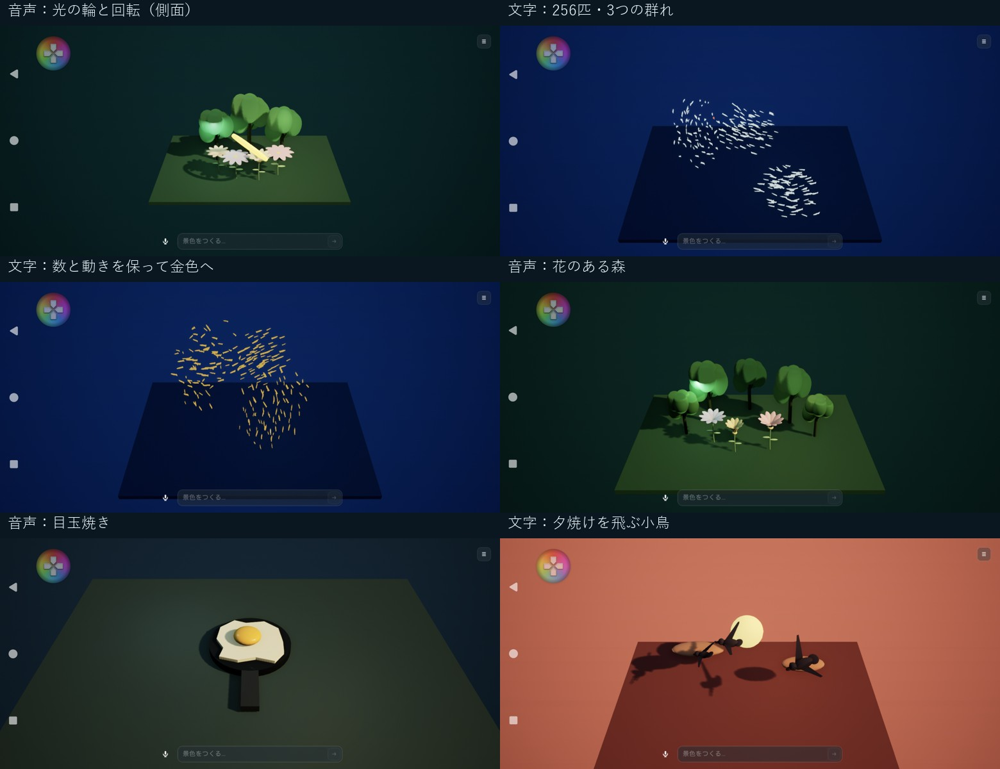
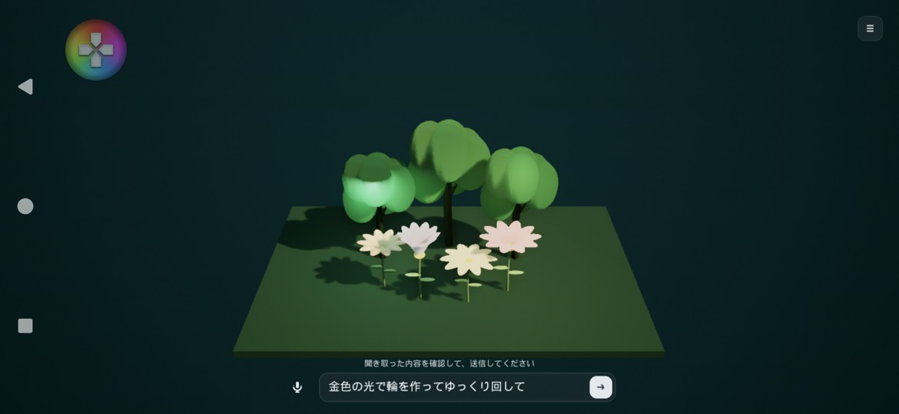
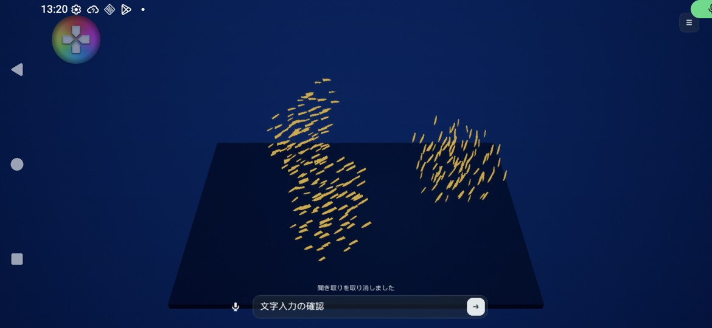

# 音声・文字入力と景色の実機レビュー

## 確認した環境と方法

2026-11-05、Xperia XQ-FS54／Android 16、2340×1080の横画面で確認しました。端末内TermuxのOpenClaw 2026.10.10からGitHub Copilotのgpt-6-lunaを使用しています。PDT-FP1そのものでは未確認です。

音声は検証用アプリが日本語の合成音声を端末スピーカーから再生し、ゲームのマイクボタンから実際のマイク・Android音声認識を通しました。認識結果を直接差し込む疑似イベントではありません。人の話し方や展示会場の雑音に対する評価は別途必要です。
文字は日本語をAndroidのキーボードで貼り付け、ゲームの送信矢印で送信しました。文字の追記・削除、キーボードを閉じる操作、聞き取り取消時の下書き保持も確認しています。

## 最終確認した6つの指示

| 入力 | 指示 | 景色と操作の確認 | 生成時間 | 推定cr |
|---|---|---|---:|---:|
| 音声 | 金色の光で輪を作って、ゆっくり回して | 認識文を確認して送信。発光する輪と軸回転が生成された。側面を向く瞬間は棒のように見える | 16.38秒 | 0.22653 |
| 文字 | 青い海の中を、256匹の魚が3つの群れで泳ぐ景色にして | 256匹・3群・群泳を確認。1つの魚の形へ集まる誤解釈を修正し、独立した群れへ再確認 | 6.79秒 | 0.13569 |
| 文字 | 魚の数と動きを変えずに、魚だけを金色にして | 数・群数・動き・配置・背景を保持。色と説明だけが変更された | 6.84秒 | 0.13490 |
| 音声 | 花のある小さな森にして | 5本の木と3つの花、花の開閉を確認。前の魚は残らない | 14.04秒 | 0.17109 |
| 音声 | 目玉焼きを作って | フライパン・柄・白身・黄身が見分けられる。前の森は残らない | 13.26秒 | 0.17899 |
| 文字 | 夕焼けの空を、小鳥が羽ばたきながら飛ぶ景色にして | 太陽・雲・3羽の小鳥、飛行と羽ばたきを確認 | 14.62秒 | 0.18126 |

正確な各実行時間と認識文は[検証記録JSON](LightBoxInputReview-2026-11-05.json)を参照してください。時間はアプリが景色生成を依頼してからの計測で、発話・確認操作の時間は含みません。
音声3件は句読点を除いて指示の意図が一致し、6件とも送信操作前にはAIへの依頼が増えていないことを記録しました。

## 修正した問題

- 音声を認識すると即座に送信され、誤認識を直せなかったため、半透明の文字欄へ下書きとして反映するようにしました。確認・修正して矢印で送ります。
- 聞き取り中に認識した途中の言葉を表示し、取消操作と状態が分かるようにしました。取消や認識失敗で既存の下書きを消しません。
- Androidのキーボード操作と送信操作が重なるケースがあったため、Androidの送信は矢印に統一しました。キーボードを閉じるだけでは送信しません。PCのEnter送信は維持しています。
- 「光の輪」が発光しない金属の輪になっていたため、光でできた被写体には発光を使うよう指示を改善しました。また、対称な形が回転しても静止して見える問題に対し、傾いた軸や識別できる細部を使うようにしました。
- 独立した複数の魚群が1つの大きな魚の形に集まる場合があったため、形を作る指定のない複数群は、それぞれの先導点を持つ群泳へ補正しました。明示的な「魚の形を作る」操作と、色だけの編集は維持します。
- アプリの強制終了・再起動で履歴が「応答待ち」のまま残る問題を修正しました。「中断・未反映」として扱い、直近の未取得利用量を取り直します。景色の生成を自動再送することはありません。
- 新規端末の起動スクリプトが初回生成したキーを保存していなかったため、専用設定へ保存して再利用するようにしました。アプリ側の暗号化保存と合わせ、通常の再起動でキーを再入力する必要がなくなります。

## 見た目の評価と残る改善点

魚の群れと対象を限定した色変更は、違いが明確でデモに使いやすい結果です。森と目玉焼きも何を作ったかはすぐ伝わります。
一方、木や雲は単純な造形で、白身の輪郭にも多角形らしさが残ります。小鳥は逆光のシルエットとして成立していますが、質感の細部は乏しい状態です。
光の輪は発光・回転が改善したものの、側面を向くと輪の穴が見えなくなるため、展示用の構図には軸と視点の調整余地があります。6件すべてを展示完成品質と評価したわけではありません。

次の品質向上は、樹木・雲・料理の形状と材質、被写体が見やすいカメラ方向を優先すると効果があります。今回の修正は、入力ミスを直せる操作と、指示に対応した変化の確実さを優先しています。

## 消費量と検証結果

途中の修正比較・やり直しを含めて15依頼を記録し、13件を反映しました。残りは取消1件、検証用の再起動による中断1件です。
判明した利用量の合計は **2.1167275cr**、この2件の利用量は未取得です。未取得を0として合計していません。最終採用の6件だけでは約1.02847crです。
これらは確定請求額や残高ではありません。アプリの「☰ → 記録」にも各実行と取得済み利用量を残しています。

- Windows Editor／Android ASTC Developmentのビルド・APK更新に成功。
- C++自動テスト37件成功、失敗0件。独立群の解釈、形の指定の維持、再起動時の履歴復旧を追加検証。
- Android Keystoreの実機テスト13項目成功。
- 記録サービスとGatewayキー保存のNodeテスト4件成功。
- 最後の実機では、キーボードを閉じる操作と音声取消による追加AI依頼は0件。再起動後の「応答待ち」は0件。
- テスト前の景色とお気に入りを復元し、追加の履歴とクレジット記録を保持しました。認証設定も保持しています。

再実行用ツールは`Tools/AndroidInputReview/`と`Tools/ReviewLightBoxInputs.py`です。検証用APKは本体に同梱しません。座標とキーボード操作は今回の実機・Gboard向けです。`--live`は実際にモデルを利用し、音声を再生します。
