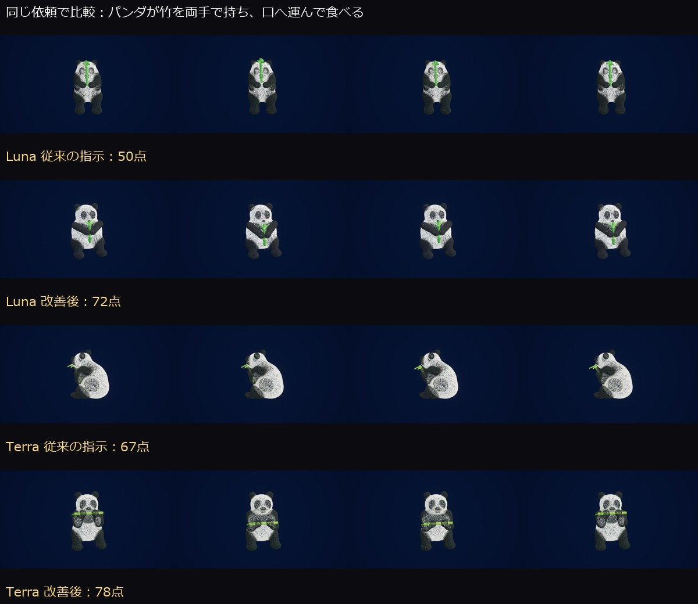

# ひかりのアトリエ モデルと生成指示の品質比較

2026年11月8日、Xperia 1 VII（Android 16）で、入力文・粒子の完成形・実際の動きを照合しました。従来の生成指示では、今回の3題はSonnetとSolが僅差で上位でした。Terraは費用と生成時間に対して良好です。上位モデルへ替えるだけでは、へたや目の見え方、手と持ち物の連動は解決しませんでした。

生成指示を見直した再試行では、Lunaは65.7点から77.7点、Terraは76.3点から80.3点になりました。この指示をアプリへ反映し、実機で生成と色編集を確認しました。

## 元の入力と表示

「ナスを作って」では紫の実と緑の茎が生成されました。ただし実は卵形に近く、へたは王冠状で、自然ななすの萼とは差があります。「形を変えずに実の色だけを青くして」では、実の色だけが変わり、形・位置・緑の部位は保たれました。保存された変更内容も、実の色と説明文の変更に限られています。

この2つの指示は回転や変形を求めていないため、静止していることは不具合として扱いません。音声の認識と色編集の成功を、造形や動作の品質と分けて評価しました。

## 比較条件

アプリの生成処理から、端末内OpenClawを経由して5モデルへ同じ3題を送りました。各題は同じ初期景色から始め、131,072粒にそろえています。観測記録で指定した5種類のモデルが実際に使用されたことを確認しました。各モデル・各題につき1試行、形式の検証で失敗した場合のみ1回まで修正依頼を許可しています。画像を見て自動的に作り直す処理は無効です。

1. 新しい景色として、なすを1本作って。紫の実と緑のへた、短い茎をつけ、ゆっくり回転しながら全体を見せて。
2. 新しい景色として、夕焼けの海の上を、白いカモメ3羽が翼を上下に羽ばたかせながら飛ぶ景色にして。
3. 新しい景色として、パンダが座って竹を両手で持ち、竹を口へ運んで繰り返し食べる様子にして。

完成後の複数画像と実機録画を確認しました。形成途中の画像は完成形の採点から除外しています。周期的な動作は録画から不等間隔のフレームも取り出し、同じ姿勢だけが重なる見落としを避けています。比較画像は縦横比を保っています。

## 従来の生成指示での採点

形は特徴・比率・輪郭、指示一致は色・数・姿勢、動きは動詞の実現・振幅・周期、見やすさは構図・色・粒子の読みやすさ、つながりは部位の接続・持ち物との接触・めり込みを評価しました。点数はCodexによる画面の主観評価です。3題の平均であり、モデル全般の性能を示す統計的な順位ではありません。時間・費用は品質点に含めていません。

| モデル | 形 /25 | 指示一致 /20 | 動き /25 | 見やすさ /20 | つながり /10 | 合計 /100 |
|---|---:|---:|---:|---:|---:|---:|
| Luna | 17.7 | 13.0 | 15.3 | 12.0 | 7.7 | 65.7 |
| Terra | 19.3 | 17.0 | 18.3 | 13.0 | 8.7 | 76.3 |
| Sol | 19.3 | 17.3 | 19.7 | 13.3 | 8.7 | 78.3 |
| Sonnet 5.5 | 18.7 | 17.3 | 19.7 | 14.3 | 8.7 | 78.7 |
| Opus 5.5 | 19.0 | 17.0 | 19.0 | 12.0 | 8.7 | 75.7 |

| 題材 | Luna | Terra | Sol | Sonnet | Opus |
|---|---:|---:|---:|---:|---:|
| なす | 66 | 80 | 81 | 81 | 78 |
| カモメ | 81 | 82 | 83 | 84 | 78 |
| パンダ | 50 | 67 | 71 | 71 | 71 |

Lunaのなすはへたが実の中に隠れ、パンダは竹だけが動いて手が追随していませんでした。Terraはなすの特徴と座る姿勢が分かりますが、食べる動きが控えめです。Solはなすの曲がりと竹を上げ下げする動きを表現しましたが、パンダの目の模様が弱めです。Sonnetは夕日の色と構図が比較的読みやすく、パンダは人形に近い体型でした。Opusはなすを回す代わりにカメラを周回させ、海の景色では主役が小さくなりました。パンダも顔の模様や食べる動きが控えめです。

全モデルで3題とも表示できました。なすや鳥は認識できますが、自然な動物の造形と、複数の部位を連動させる動きには、まだ改善の余地があります。

## 時間と費用

| モデル | 表示反映 | 平均応答時間 | 平均推定cr | 修正依頼 |
|---|---:|---:|---:|---:|
| Luna | 3/3 | 42.3秒 | 0.410 | 1件 |
| Terra | 3/3 | 23.1秒 | 2.434 | 0件 |
| Sol | 3/3 | 38.0秒 | 5.315 | 0件 |
| Sonnet 5.5 | 3/3 | 24.6秒 | 6.637 | 0件 |
| Opus 5.5 | 3/3 | 67.1秒 | 23.135 | 1件 |

応答時間は修正依頼を含むアプリ内計測値で、粒子の組み立て完了までの時間とは異なります。費用は観測された実モデル・入出力・キャッシュ読み書き量と、保存済み単価表から求めた推定値で、確定請求額ではありません。比較15件の合計は約113.8 crです。既定モデルを変更する根拠になるほど大きい品質差ではないため、利用者の保存済みモデル設定は変更しません。

## 生成指示の改善

第1案では、部品数より特徴の見え方を優先すること、色の異なる部位をほかの部位に埋めないこと、手と持ち物を同じ姿勢・時刻で動かすことを追加しました。Luna・Terra・Opusの9件で比較すると、平均はそれぞれ73.7・76.0・80.0点でした。Lunaのパンダは改善しましたが、なすが斜めの軸で横倒しに回転したため、そのまま採用しませんでした。

最終案では、通常の回転展示は上下を保って縦軸で20〜40秒かけて一周し、横倒しの回転は求められたときだけ使うことを追加しました。LunaとTerraで同じ3題、計6件を再生成した結果です。

| モデル | 従来の平均 | 最終案の平均 | なす | カモメ | パンダ |
|---|---:|---:|---:|---:|---:|
| Luna | 65.7 | 77.7 | 78 | 83 | 72 |
| Terra | 76.3 | 80.3 | 81 | 82 | 78 |

Lunaのなすは縦軸で30秒の回転になり、へたも以前より見えます。パンダは竹だけでなく両腕・手も連動するようになりました。Terraのパンダも、竹を下げた姿勢から口元へ運ぶ姿勢への変化が明確になりました。一方、Lunaのへたの一部はまだ埋もれ、パンダの目・口の細部や自然な体型には不足があります。

[Terraの改善前後を並べた12秒の実機動画](images/quality-terra-before-after.mp4)では、手と竹の上下動の差を通常速度で確認できます。

この最終案をアプリの共通生成指示に反映しました。最終案の点数はLunaとTerraでの今回の試行結果です。Sonnet・Sol・Opusの最終案の点数を推測して、比較表へ加えることはしていません。生成にはばらつきがあるため、毎回同じ向上幅になるとは限りません。

変更後のAndroidアプリでも、なすの生成に続けて「形や動きを変えずに、実の色だけを青くして」を実行し、形・回転・緑の部位を保った編集を確認しました。自動確認89件も成功しています。比較・改善・導入後の確認は計32ケース、推定消費量は約197.9 crでした。

## 比較画像と再現用の記録

- [なすの5モデル比較](images/quality-baseline-00.jpg)
- [カモメの5モデル比較](images/quality-baseline-01.jpg)
- [パンダの5モデル比較](images/quality-baseline-02.jpg)
- [入力文・生成された景色・観測モデル・項目別採点の記録](reviews/2026-11-08/model-quality.json)

各比較画像は上からLuna・Terra・Sol・Sonnet・Opus、左から時間順です。生データと録画は `Saved/ModelQualityReview/` にあります。最初の2件の録画は監視の再接続時に撮影対象がずれたため、動きの評価には使用せず、元の画面画像と保存した景色の再生で確認しました。

再生確認した従来の5景色（Lunaの3題、Terra・Opusのパンダ）は、131,072粒・約59.7〜60.0 fpsでした。したがって、今回のパンダの動作が乏しく見える問題は、この範囲では描画の処理落ちよりも生成された動作の設計にあります。全15景色の描画速度を測った値ではありません。

最終案のLuna・Terraのパンダも、再生時は約59.9 fpsでした。比較用の生成は開発ビルドの `-LightBoxBench`、保存済み景色の再生はAIへ接続しない `-PointCloudReview` を使いました。実行・録画は `Tools/RunModelQualityAndroid.py` と `Tools/ReplayModelQualityAndroid.py`、集計は `Tools/ReviewModelBench.py` です。
