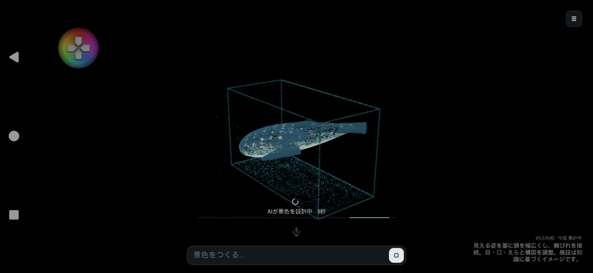
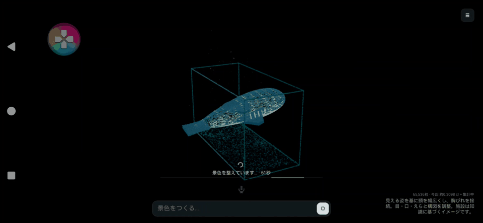
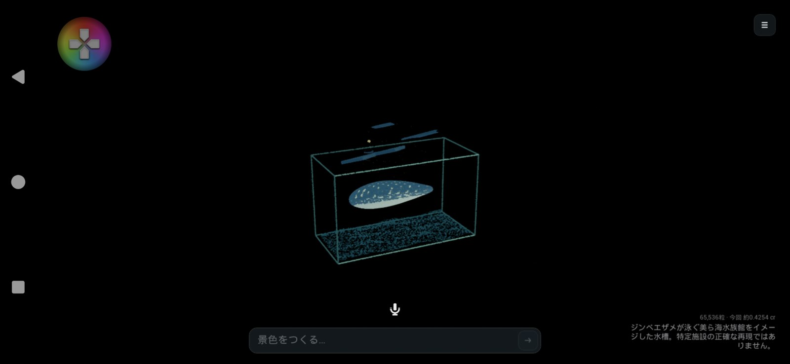
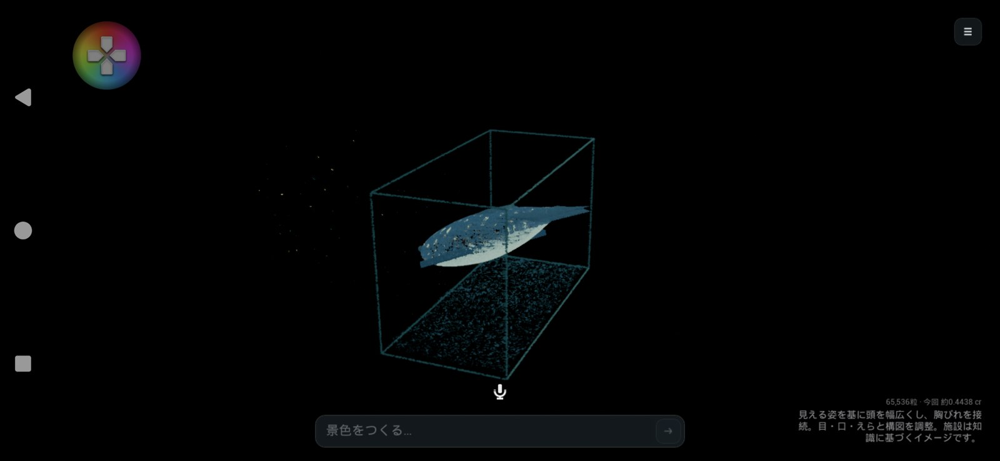
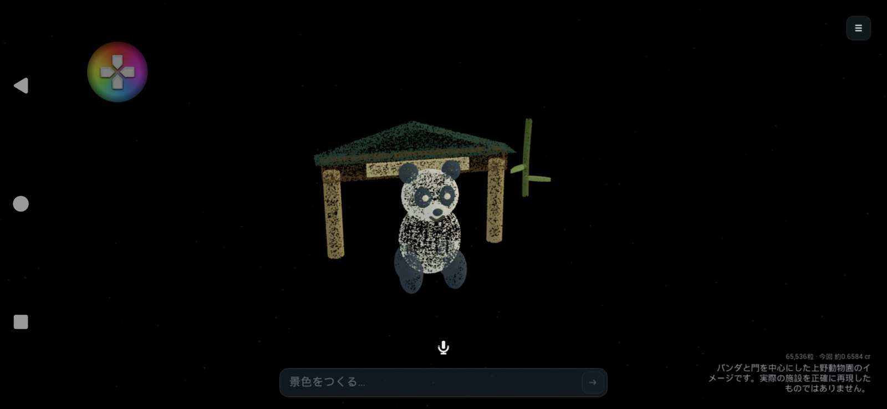

# 差分の移動・進捗表示・造形の改善

ひかりの箱の景色は、引き続きすべて粒子で描きます。通常モデルの描画・床板・背景板は追加していません。

## 粒子の移動

OrbitCalendarの「変わらない部分を残し、変わる部分を各目的地へ移す」方式を3Dの粒子に適用しました。

- 部品のIDと部品内のサンプル番号を安定させ、色や照明だけの変更で位置を取り直しません。
- 同じ部品と親の動きが維持される場合、羽ばたき・飛行を継続します。ほかの部分が形成中でも、その場で待ち直しません。
- 変更する部分は空間的に近い順に一対一で対応付け、各目的地へ吸い寄せます。最後に減速し、移動距離に応じた小さな弧と時間差をつけます。
- 新しく必要な粒はそれぞれの目的地付近から出現し、不要な粒は現在地で小さくなって消えます。共通の中央集合地点はありません。
- 準備中も旧景色を動かし、切り替える瞬間の位置から移動を開始します。途中で別の変更が来た場合も同じ扱いです。

対応付けは総当たりの最短距離探索ではなく、空間の並びを使った近似です。最大100万粒に対して二乗の計算量にならないようにしています。変更しない部品でも、総予算の再配分で不要になった粒は消えます。すべての粒の永久固定や、厳密な最短輸送を保証するものではありません。

## 進捗と常設表示

音声の聞き取り・AIの待機・画像レビュー・修正再試行・粒子配置の準備を表示します。時間が読めない処理は、短い光が動く細いバーと経過秒数で表示します。AIの内部完了率や残り時間は取得していません。

粒子が移動を始めた段階では、設定された形成時間に対する0〜100%を表示します。形成アニメーションの進捗であり、AIの思考の進捗ではありません。停止ボタンでAIの待機を取り消せます。

右下には次を控えめな文字で常時表示します。

```
65,536粒 · 今回 約0.2000 cr
現在の景色の説明
```

粒数は実際に存在する描画インスタンス数です。減らしている途中は、まだ消えていない粒も含みます。クレジットは直近の依頼単位で、失敗した初回と修正再試行の分を合算します。取得待ちは「集計中」、一部のみ判明した場合は取得済みの値に「＋集計中」を付けます。ドル表示はありません。累計や個別のトークン数はメニューの「記録」で確認できます。

説明は景色の保存データの`note`を表示するため、カメラ操作や一時通知で消えません。記録・保存の呼び出し、戻す・やり直すにも追従します。クレジットは推定利用量で、確定請求額や残高ではありません。

## 造形の指定能力

AIが参照するものは、入力文、現在の景色、利用できる形・動きの仕様、学習済み知識です。通常生成で施設の写真を検索したり、モデルファイルをダウンロードしたりしません。

追加した指定は次の通りです。

| 指定 | 用途 |
|---|---|
| `shape:loft` / `sections` | 長手方向に幅と高さの異なる断面をつなぐ。幅広い頭、細い尾、非円形の胴体など |
| `pattern` / `patternColor` / `patternScale` | 点ごとの斑点・縞・斑模様。小さな球を大量に並べる必要がない |
| `belly` / `bellyColor` | 部位の下側を別の色で表す |
| `attached:true` | 親のある部品に接続を要求し、明確に離れた配置を検証で拒否する |

`loft`の断面は`[x,半幅,半高さ]`で、xは−0.5〜0.5の昇順、半幅と半高さは0〜0.5。3〜24断面を使い、両端は幅・高さ0で閉じます。`size`で実寸へ拡大し、`curve`で中心線を曲げられます。これは数学的な粒子の配置面であり、通常のモデルとして描画しません。

親を指定した部品の位置は**親からの相対位置**です。例えば親が`[0,0,100]`、目標の世界位置が`[20,-30,90]`なら、子は`[20,-30,-10]`です。親の高さを二重に加算しないよう、AIへの指示に具体例を加えました。

接続検証は配置面の境界箱を使った粗い検査です。形の正確な接触、解剖学的な正しさ、部品同士のめり込みや、groupの子同士の接続を保証しません。通常の軌道運動など、離れてよい子には`attached`を使いません。

AIには、題材を特徴づける形・比率・模様を先に設計し、顔・ひれ・耳・尾などへ粒を配分するよう指示しています。特定の施設名を完成済みモデルへ置き換える判定は追加していません。

## メニューの「造形を磨く」

景色が完成したら **☰ → ☆ 造形を磨く** を押せます。操作UIを除いた現在の景色を最大1280画素の画像にし、現在の設計図とともにOpenClawへ送ります。AIが見える輪郭・比率・接続・顔・模様・構図を評価し、改善した設計図を返します。変更点は右下の説明に残ります。

通常生成とは別のAI呼び出しで、追加のクレジットと待ち時間が発生します。毎回の生成を遅くしないよう、自動では実行しません。画像入力に対応するGatewayとモデルが必要です。画像非対応のHTTPエラーでは現在の景色を保持して案内を表示します。画像から実物の形を完全復元する機能ではなく、見えていない面の検証やWeb上の参考資料の取得は行いません。

## 実機確認

2026-11-06、Xperia 1 VII（XQ-FS54／Android 16／2340×1080）で、端末内OpenClawとCopilot `gpt-6-luna`を使用しました。

| 操作 | AI応答時間 | 推定cr | レビュー |
|---|---:|---:|---|
| 文字「美ら海水族館」 | 53.6秒 | 0.4254300 | 断面と斑点を使用。ただし初回はひれ・目などの位置が胴体から離れた |
| 「造形を磨く」で画面を送信 | 63.9秒 | 0.4438175 | 子の座標が親からの相対位置になり、胸びれ・尾・目・口・えらの接続と構図が改善 |
| 音声「上野動物園」 | 36.4＋28.7秒 | 0.6583725 | 認識語は依頼どおり。竹の葉の接続ミスを検出し1回組み直し。パンダの顔と四肢、門、竹を生成 |
| 白い部分の色だけを薄いピンクへ変更 | 36.7秒 | 0.4159550 | 胴体・頭・口元の3部品の色を変更。形・配置・動作・カメラ設定を維持 |

端末への検証依頼は合計 **1.943575 cr**。失敗した初回・修正再試行も含み、アプリの右下でも依頼単位の合算を確認しました。音声は端末の読み上げ音を実際のマイクへ入れる方式で検査しました。初回はメディア音量0で読み上げが入らず、試験中だけ調整して再検査し、最後に0へ戻しています。騒がしい展示会場での認識精度を保証する試験ではありません。

AIの待機時間自体は短縮していません。特に組み直しは追加の待機と利用量を伴います。バーはこの状態を見えるようにする機能です。





### 造形のレビューと修正

初回の水族館では、幅と高さを断面ごとに変えた胴体と粒子単位の斑点が生成されました。しかし子の位置に世界座標を入れており、ひれ等が胴体の上へ離れました。



実際の画面を送ったレビューでは、子の位置が親からの相対値に変わり、接続が改善しました。この発見を一般の部品にも適用するため、相対座標の具体例と`attached`の接続検査を追加しました。「上野動物園」の試験では、竹の葉の同種のミスをこの検査が拒否し、修正後の景色だけを適用できました。





形は引き続き簡略化されており、ジンベイザメの頭・尾の比率、パンダの肩や腕、細部の自然さには改善余地があります。接続しただけで高精度な造形になるわけではありません。画像レビューは実物との一致を保証せず、視点によって見落とす箇所もあります。

### 自動検証・粒数・データ保持

Windows自動テストは **51件成功・失敗0件**。差分の保持、違う羽ばたき時刻でも同じ粒の配置面を使うこと、空間的な対応付け、途中の変更、100万粒の上限、断面や模様、親からの相対座標、進捗・クレジット集計、画像レビュー前の画像保存、従来の動作を対象としています。端末用補助ツールのNode.jsテスト4件も成功しました。

Androidでは固定した「なす」の見本を約8秒測った参考値として、65,536粒で約50.2fps、100万粒で約11.9fpsでした。フレーム間隔p95は37.7ms／242.0msで、100万粒は滑らかな展示用の常用値ではありません。両ケースとも実インスタンス数が指定数と一致し、通常モデルを描く部品は0個でした。

最終APKでは65,536粒の景色から144粒のホタルへ切り替え、余分な粒が現在地で消え、メニュー外の表示も144粒になることを確認しました。描画検査の前後で利用者の履歴が同一であること、保存済み景色のファイルがバイト単位で変わっていないことを確認しています。認証情報を消す操作は行っていません。

詳細な返答・秒数・利用量・検査結果は[検証JSON](ParticleExperienceResults-2026-11-06.json)を参照してください。
