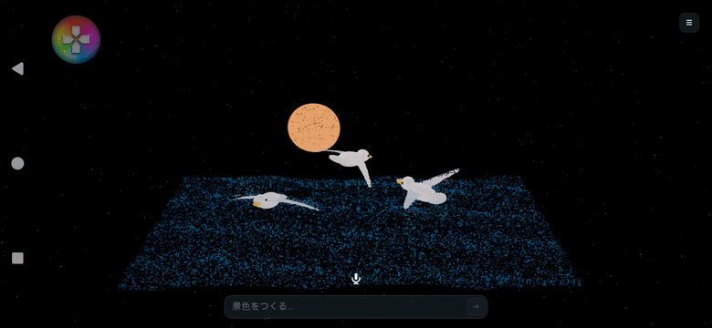
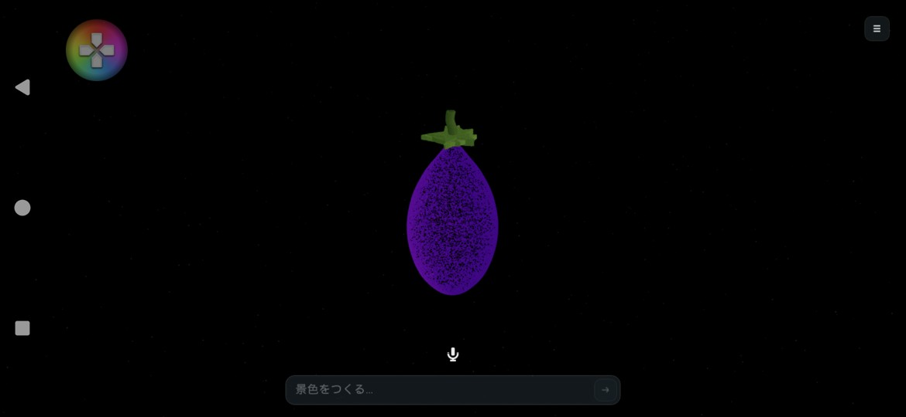
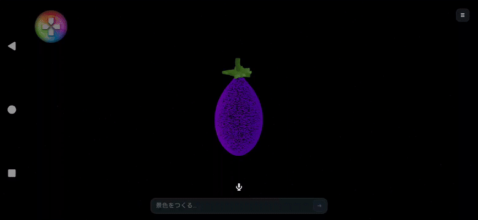

# すべて粒子で描く「ひかりの箱」

現在の名称は**ひかりのアトリエ**、新しく作る立体の標準は**131,072粒**です。以下の実測・画面は変更前の検証記録です。

差分を保つ移動・進捗バー・右下の常設表示・画像を使う造形改善については、[新しい操作と検証](ParticleExperience.md)を参照してください。以下の実測は粒子統一時点の記録です。

2026-11-06から、ひかりの箱の景色は**鳥・海・太陽・背景を含めて粒子だけ**で描きます。通常の3Dモデルへ切り替える処理は削除しました。

## 削除したもの

- 景色用の通常モデル／プロシージャルメッシュの描画経路。
- 自動で敷く床、マット、箱の枠、床のグリッド、背景板。
- 球や尾のモデルで光・魚を描く従来の描画経路。
- モデル・床・背景用の素材5個と、スタジオ環境用の画像1個。
- タイトルの「ひかりの箱」プレビューにあった柱・枠・球のモデル。

文字入力・マイク・メニューなどの操作UIはそのままです。形状計算には内部の数学的な曲面・輪郭を使用しますが、それらを通常モデルとして画面へ描きません。各粒子を描く小さなカメラ向きの円盤だけをGPUへ渡します。

## 粒子の動き

「なす」では胴体・へた・茎へ粒子が集まり、別の形の指示では現在位置から移動します。標準の集合時間は5秒です。

「カモメが羽ばたきながら飛ぶ」では、粒子が翼の動きと飛行に追従します。波、花の開閉、回転、曲線の流れ、部品の親子連動にも同じ描画を使います。鳥のモデルを重ねる方式ではありません。

形が決まったときに各粒子の位置と追従先を準備します。その後は、形を制御する少数の点を最大毎秒30回更新し、全粒子の位置とフレーム間の補間をGPUで計算します。100万粒すべての座標を毎フレームCPUから送ったり、AIへ問い合わせたりしません。自由に動くホタルなどには端末内の少数の光のシミュレーションも使いますが、描画は同じ粒子です。

大きな海が鳥の粒子を使い切らないよう、形ごとに粒の密度・大きさを調整しています。暗い保存済みの色も点が見える明るさに調整し、スマートフォンで点が1画素未満になって消えないよう最小表示サイズを設けています。背景色は遠方の疎らな粒子の色に使います。空を塗る背景板や水面の反射画像はありません。

## 保存データとAIの操作

- 従来の保存・履歴・見本も、読み込み時に粒子表示へ変換します。元の保存ファイルを削除しません。
- `pointCloud.enabled:false`、`floor:true`を持つ旧JSONも読み取れますが、粒子表示・自動の床なしへ正規化します。通常モデルを再有効化するスイッチはありません。旧版で未使用だった粒数設定が小さい場合は、読み込み時に131,072以上へ補い、輪郭が崩れないようにします。
- `pointCloud.count`は景色全体の上限（最大1,000,000）。通常131,072を基準にします。少数の光だけの景色は実際の使用数が少なくなり、メニューには実際の粒数を表示します。
- `objects`は粒子の到着面・色・動きを指定する計算用の記述です。`animation`、`motions`、曲線・輪郭・親子関係は引き続き使えます。
- `particles.count`（0〜1024）は自由に動く光の指定で、景色全体の粒数予算に含めます。
- `roughness`・`metallic`・自動の床・枠は旧データを読めるよう残した値で、通常モデルの材質や板は描きません。光の色・強さ・方向は粒の色へ反映します。

ドラッグ、ピンチ、自動回転、視点リセットは維持しています。形の集合中も、羽ばたき中も見回せます。音声・文字入力の送信方法、クレジットの記録方法は変えていません。

## 制限

これは粒子で形を表し、形の動きに追従させる演出です。100万粒すべての相互作用・衝突・流体物理を計算する方式ではありません。任意のモデルファイルやコードを生成して読み込む機能もありません。造形の正確さは、AIが組み立てる輪郭や部品の設計に依存します。

動く形の粒子色は形の準備時に決め、位置を継続更新します。通常モデルの金属反射や物理的な影の再現はありません。高密度では点が重なって面に近く見える場合がありますが、描かれているのは粒子です。

## 確認方法

Windows自動テストは45件成功・失敗0件。粒子自体の飛行／変形、フレーム間補間、100万粒の上限、途中での目的地変更、旧保存データの変換、通常モデル用の描画部品を作らない構成を検査しています。

Androidでは、AIへ接続しない専用モードで実際の表示とフレーム間隔を測り、表示中の景色に通常モデルを描く部品が0個であることを確認します。開発版のUnreal Engineが作るデバッグ用補助部品は別欄に記録し、景色のモデルとは区別しています。検査中に利用者の履歴が変わらないことも比較します。

```powershell
adb install -r Package/LightBox/Android_ASTC/SpresenseMaze-arm64.apk
python Tools/ReviewParticleScenesAndroid.py
```

描画用の形状例は、リポジトリ内の`Docs/LightBoxCameraReview-2026-11-05.json`にある旧版の景色を使用します。新しいAndroid端末の準備は[セットアップガイド](SetupAndDevelopment.md#新規android端末でひかりのアトリエを使う)を参照してください。

## Xperia 1 VIIの実測（2026-11-06）

XQ-FS54／Android 16、2340×1080、Android ASTC Development。集合が完了してから約8秒のフレーム間隔を測っています。動く景色では羽ばたき・波・光の移動を継続させたまま測定しました。初回負荷を除外せず、長時間の発熱を保証する測定でもありません。

| 景色 | 粒数 | 平均fps | フレーム間隔p95 | 通常モデル描画部品 |
|---|---:|---:|---:|---:|
| 旧データの鳥と海（移行） | 65,536 | 41.1 | 36.6ms | 0 |
| 羽ばたく鳥と波打つ海 | 65,536 | 41.1 | 36.6ms | 0 |
| ホタル・星・木 | 65,536 | 50.0 | 36.6ms | 0 |
| 羽ばたく鳥と波打つ海 | 1,000,000 | 8.2 | 149.2ms | 0 |
| なすの形 | 1,000,000 | 9.9 | 100.8ms | 0 |

各ケースで、指定した数の粒子インスタンスが存在すること、通常モデルを描く部品が0個であることを検査しました。開発用の`GameplayDebuggerRenderingComponent`はエンジンのデバッグ補助であり、モデル描画数とは別に記録しています。検査前後の利用者の履歴は同一でした。100万粒は描画可能な上限で、滑らかな展示の常用値には適しません。



## 実際のCopilotへの依頼とレビュー

端末内OpenClaw／Copilot `gpt-6-luna`へ文字入力で依頼しました。音声経由は今回の検査に含めていません。

| 依頼 | 結果 |
|---|---|
| 正面で停止したカメラ、光の粒子の白い3羽のカモメ、青い海と夕焼け | 白い粒子の翼が羽ばたき、青い粒子の海が波打つ。太陽も粒子 |
| 粒子が集まって、なすの形を作って | 初回は自由な光の上限を超えて修正。修正後も輪郭だけになり、立体のなすとしては不十分だった |
| 指示補強後に「なすを作って」 | 実の回転体、へたの中心、5枚の葉、曲線の茎から、粒子で立体を生成。追加の組み直しなし |

「粒子が集まる」という言葉を、少数の光が輪郭をなぞる指定と解釈したことが原因でした。具体的な物は粒子で満たした立体として作ること、`objects`が通常モデルではなく粒子の配置を計算する記述であること、輪郭だけの表示は明示的に頼まれたときに使うことをAIへの指示に補強しました。特定の「なす」を選ぶプリセット判定は追加していません。





集合途中での戻す・やり直す、完成したなすから鳥への変化を追加のAI呼び出しなしで確認しました。最後は白い粒子のカモメと青い粒子の海を表示しています。元の保存済みの景色はファイルのハッシュが変わっていないことを確認しました。

記録クレジットは合計 **0.8292325 cr**。輪郭だけになった試験と、その組み直しの分も含みます。描画検査と戻す・やり直す操作はAIを呼ばないため追加クレジット0です。アプリ内にも記録を残しています。詳細は[検証JSON](ParticlesOnlyResults-2026-11-06.json)に保存しています。

造形はまだ単純化されており、鳥やへたの細部は改善余地があります。高密度の粒子が重なると面のように見える場合もありますが、通常モデルを重ねて描いてはいません。粒子を配置する形状の設計には、引き続きAIの生成品質による差があります。
