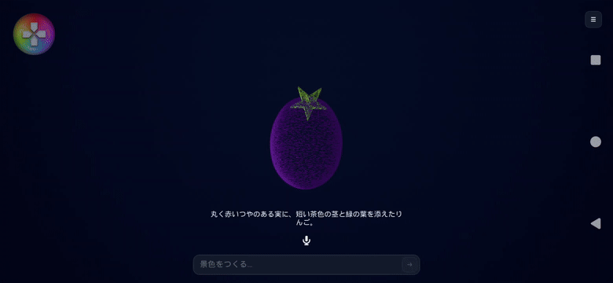

# 粒子が立体を作る「ひかりの箱」

**現在は通常モデルの描画を削除し、すべて粒子へ統一しています。** 最新の仕組み・羽ばたき・波・実測は[粒子のみの描画](ParticlesOnly.md)を参照してください。

対象は **Xperia 1 VII（XQ-FS54／Android 16）**。Spresenseの箱とUSB接続し、端末の画面・マイク・TermuxのOpenClawを使います。Copilotは通信先で形の設計を担当し、粒子のアニメーションは端末内のUE5で動きます。

## 体験

「なす」などの名詞から、AIが色付きの立体部品を組み立てます。その表面を粒子の目的地に変換し、現在の粒子位置から曲線を描いて集まります。次に「りんご」と入力すると、なすを構成していた粒子が移動して別の形になります。

- 通常 **65,536粒**。指定可能な範囲は256〜**1,000,000粒**です。100万粒は常時使う数ではなく上限です。
- 集まる時間は標準5秒、1〜15秒で変更できます。弧の大きさ・回転数・出発のばらつきもAIから変更できます。
- 途中で別の指示が確定した場合は、その時点の位置・色・大きさから次の形へ向かいます。カメラも補間します。
- 自動の床・枠・背景板は削除しています。地面や海が必要な場合も、点で表す形として指定します。
- 傾きで立体が傾きます。`shake:scatter`なら振ったときに散って戻り、`none`なら反応しません。
- 画面上の文字を増やさず、粒数とクレジットはハンバーガーメニュー内で確認できます。
- 景色の中央をドラッグすると360度見回せます。ピンチで拡大縮小、メニューの「自動回転」「視点を戻す」も使えます。これらは従来の動く景色にも共通です。[カメラ操作とアニメーションの指示](LightBox.md#アニメーションとカメラの指示)を参照してください。



これは実際のCopilotへの文字入力で生成された形です。専用のなすモデルへの置き換えではありません。生成結果は毎回変わります。

## AIが操作する内容

スキーマ3の`pointCloud`で粒数と集合の動きを指定します。旧データも粒子で読み込みます。`enabled:false`と`floor:true`は互換性のため読み取りますが、粒子表示・床なしへ正規化します。

```json
"pointCloud": {
  "enabled": true,
  "floor": false,
  "count": 65536,
  "duration": 5,
  "arc": 65,
  "twist": 1.25,
  "stagger": 0.35
}
```

`count`は整数、`arc`は0〜200cm、`twist`は−4〜4回転、`stagger`は0〜0.75です。既存の`particles.count`（0〜1024のCPUシミュレーション）とは独立しています。粒子彫刻では通常`particles.count:0`とし、`objects`を到着面に使います。

形の語彙を増やすため、既存の球・ポリゴン・曲線チューブ・葉などに、汎用の**回転体`lathe`**を追加しました。

```json
{
  "id": "body", "shape": "lathe", "color": "#6E27BA",
  "position": [0, 0, 160], "size": [110, 90, 200],
  "profile": [[-0.5,0],[-0.3,0.4],[0,0.5],[0.35,0.2],[0.5,0]],
  "curve": [[-12,0,-100],[0,0,0],[20,0,100]]
}
```

`profile`は`[高さ,半径]`を3〜32個。高さ−0.5〜0.5の昇順、半径0〜0.5、両端の半径0です。滑らかな輪郭を補間し、`size`で拡大します。`curve`は中心線のXY方向の曲がりをcmで与えます。Zは輪郭側で決まります。野菜・果実・花瓶・ボトル・手足などに共通して使えます。茎や葉は別部品として接続します。

特定の名詞からプリセットを選ぶ処理はありません。ただし自由な任意プログラムや無制限のメッシュ生成を許可する方式でもなく、これらの部品・輪郭・接続・色をAIが組み合わせます。複雑な題材の正確さは生成結果次第です。

## 描画の仕組みと限界

形が変わるときに、バックグラウンドで数学的な曲面から粒子の配置を作り、出発位置・到着位置・色をテクスチャへ送ります。大きな海で鳥などが埋もれないよう、部位ごとの密度と粒の大きさを調整します。各粒はカメラに向く小さな円形の板です。移動経路はGPUの頂点シェーダーで計算し、毎フレーム全粒の座標をCPUから送信しません。完了後は出発位置の読み取りや移動用の計算を省きます。

これは**GPUでの頂点アニメーション**です。Niagaraによる100万粒の物理・衝突・群れの相互作用シミュレーションではありません。照明の色・強さ・方向・局所光は目的地を作るときに粒の色へ焼き込みます。点の材質に金属反射や写実的な表面質感はありません。

対応する粒子の動きは、集合・形の変化・色や粒数の変更・傾き・散開に加え、羽ばたき・波・花の開閉・部品の連動・曲線の流れです。形状の少数の制御点を更新し、各粒子の追従とフレーム間の補間をGPUで行います。通常モデルを描く代替経路は削除しました。

## 旧版の実機確認（2026-11-05）

以下の数値と映像は初期版の記録です。現在の粒子アニメーションの値は[最新記録](ParticlesOnly.md)を参照してください。

Xperia 1 VII、2340×1080の画面、Android_ASTC Development、なすのテスト形状、形の完成後約8秒間のフレーム間隔を計測。AIには接続しない専用モードを使用し、指定した数のインスタンスが存在すること、利用者の履歴が変化しないことも確認しています。

| 粒数 | 平均fps | フレーム間隔p95 |
|---:|---:|---:|
| 10,000 | 59.7 | 17.4ms |
| 65,536 | 55.7 | 27.4ms |
| 100,000 | 50.2 | 32.6ms |
| 300,000 | 40.7 | 58.9ms |
| 1,000,000 | 12.4 | 174.4ms |

短時間の測定で、シェーダー・描画パイプラインの初回負荷も含みます。移動中の値や長時間展示での発熱・電池消費を保証するものではありません。最適化後の再測定では100万粒は約12〜15fpsに変動しました。100万粒を滑らかな展示の標準値にはせず、まず約6万5千粒で構図と形を整える方針です。

実際のTermux OpenClaw／Copilot（`gpt-6-luna`）への操作確認：

| 入力 | 結果 | 待ち時間 | 記録クレジット |
|---|---|---:|---:|
| なす（文字） | 回転体の胴体＋ポリゴンのへた＋曲線の茎、65,536粒 | 33.7秒 | 0.2122675 |
| りんご（文字） | 回転体＋茎＋葉、65,536粒。なすから5秒で移動 | 15.4秒 | 0.1687925 |

計 **0.38106 cr**。アプリの履歴にも残しています。クレジットは連携サービスが返す記録値で、請求額への換算は契約と料金設定に依存します。100万粒の描画試験はAIを呼んでいないため追加クレジット0です。

音声のマイク開始・聞き取り表示は確認しましたが、今回の端末スピーカー→マイクの自動再生では音声を取得できず、音声での形生成は今回の合格項目に含めていません。直接の発話で再確認が必要です。音声認識後の自動送信、文字入力の矢印による送信は既存仕様を維持しています。

造形のレビューでは、なすは認識可能ですが胴体が丸めで、へたが前向きになりました。部品を接触面の向きに合わせること、茎・へた・葉を接続することをAI指示に補強しました。写実的な完成モデルの品質に到達したという評価ではありません。

## 開発と再確認

`Content/LightBox/M_PointSculpture.uasset`と`T_PointData.uasset`を同梱しています。シェーダーを変更した場合は、Androidのcook前に再生成します。

```powershell
& 'D:/Epic Games/UE_5.8/Engine/Binaries/Win64/UnrealEditor-Cmd.exe' "$PWD/SpresenseMaze.uproject" -run=pythonscript "-script=$PWD/Tools/CreatePointSculptureAssets.py" -unattended -nullrhi
python Tools/ReviewPointCloudAndroid.py
```

ADBで接続した端末にAPKを更新インストールしてから計測してください。レビュー用の起動ではAI通信・認証情報の読み取り・履歴保存を行わず、終了時に通常の景色と履歴へ戻ります。出力は`Saved/PointSculpture/phone/`です。`Tools/PointCloud/fixtures.py`は描画検査用データで、実行時の名詞変換には使用しません。

自動テストには最大粒数・不正な輪郭の拒否・集合経路の始点/終点・途中での目的地変更・照明による色の変化・粒数だけの編集による形の維持を含めています。
