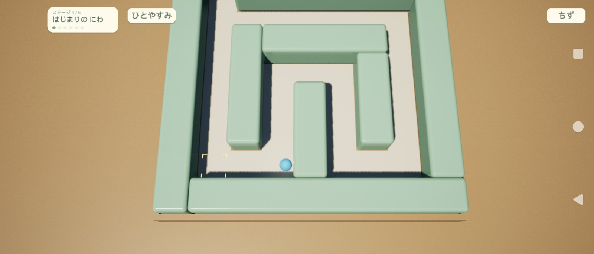
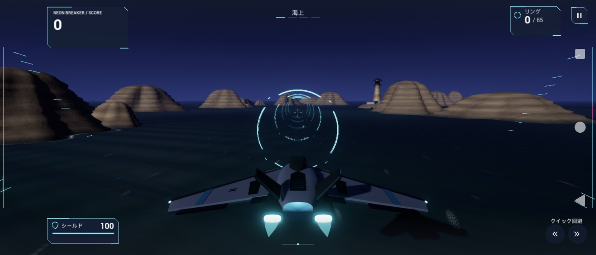

# 迷路・フライトのデザイン実装（2026-11-08）

迷路は本物の素材感がある子供向けのおもちゃ、フライトは光と速度を強調するサイバーアクションへ更新しました。

## 迷路

- 専用のライティング対応マテリアル `M_ToyEnamel` と `M_ToyWood` を追加。壁は低い金属度と光沢、床は落ち着いた粗さ、台座と外枠は細い木目で描画します。
- 6ステージの壁色を変更。アンバーの操作対象、赤い危険、青い移動という既存の役割は維持します。
- カメラを引き、縦方向の視野を横長端末でも保ち、盤面の内側へ緩やかに視点を寄せます。既存マップ内のカメラ設定にも実行時に適用します。
- 明るい立体ボタン、ひらがなの名前、数えられる進行表示、見えているゴールのラベルを追加。地図は「ちず」で開閉します。
- 「ひとやすみ」は実際に世界を一時停止し、ボール・仕掛け・ステージ時間を止めます。専用PlayerControllerにより停止中のタッチも受け付けます。
- 操作説明・クリア・ランキングも暖色の見た目に統一。接続や持ち方の案内は必要時に表示します。

## フライト

- `NEON BREAKER` のシアン／マゼンタと斜めのパネルを導入。スコアとコンボを左上へまとめ、機体上のコンボパネルを外しました。
- コースのみ夕暮れの青紫の空・照明・ブルームへ変更。機体は青い金属塗装、エンジン・翼端・リングはシアン、敵性表示はマゼンタです。
- コンボで勢いが増す画面端の速度線と流れるレール、リング通過時の拡大・回転・円弧、回避時の回転アークとシールド状態表示を追加。
- 既存の自動射撃・回避・スタミナ・得点ルールに連動します。新しい画面演出は描画数を固定し、中央の照準付近を空けています。
- 開始・休止・ボス・リザルトにも同じパネル表現を適用しました。

## 確認結果

- Windows Editor Developmentビルド成功。
- Android ASTC Developmentビルド・APK作成成功。接続端末に `adb install -r -t` で更新。
- フライトの既存自動テスト8件成功。Windowsの実ゲームレビューでは回避開始、連続回避の拒否、無敵、コース内制限、休止中のクールダウン停止を確認。
- Windowsで1600×900／2340×1080のゲーム画面を確認。最終の迷路カメラ・地図・休止・ランキングも2340×1080で再確認。休止・再開の実ハンドラーも検証。
- Androidの2520×1080画面で迷路の通常画面・第4ステージ・クリア画面を確認。「ひとやすみ」と「つづける」は実際のタップで確認。
- Androidのフライトを録画し、カウントダウン、リングとコンボ、回避シールド、休止、ボス、結果画面を確認。結果画面は保存しないレビュー用の合成記録です。
- AndroidのAI履歴と `LightBox_v1.sav` は確認前後でバイト一致。AI生成依頼は実行していません。

実機フライトの共有ログは別のLightBox起動に切り替わっていたため、ログからの判定は採用していません。フライトの判定検証はWindowsの専用レビューで行い、実機は録画と描画画像を目視確認しました。Spresense実機の持ち替えや長時間プレイの全条件までは未検証です。

## 出力と再確認

- APK: `Package/ToyCyber/Android_ASTC/SpresenseMaze-arm64.apk`
- Windows画像: `Saved/ToyCyberReview/2340x1080/`、最終カメラのホームとプレイは `Saved/UiRefresh/2340x1080/`
- Android画像・動画: `Saved/ToyCyberReview/Android/`。`flight-preview.mp4` は実機録画の18秒抜粋。
- 素材生成: `Tools/CreateToyMaterials.py` をUEのPython commandletで実行。
- Windowsレビュー: `python Tools/ReviewToyCyber.py --width 2340 --height 1080`
- Androidレビュー: `python Tools/ReviewToyCyberAndroid.py`。端末を他の作業から操作しない状態で実行してください。ゲーム内のレビュー状態と実際のタップを使い、終了時に通常の選択画面を開きます。

APK SHA-256: `ad042c66475ee6a9818a522cb3ff384353022434f15338536021e5938c0e8613`

## 迷路の見通しと丸みの調整

- カメラ距離を2450から3250へ約33%拡大し、俯角を68度から74度へ変更。進路をより上から見渡せる構図にしました。
- 壁の段差状の縁を、半径32の連続した丸みに変更。なめらかな法線を持つ立体形状で、実際の照明によるつやと影を残しています。
- 壁は明るいミント・水色などの配色へ、木部は明るい蜂蜜色へ変更。露出も上げました。
- 壁の見た目と既存の衝突形状を分離し、従来の壁判定とジャンプ上限を保持しています。
- Windowsビルドと新しい形状テスト `SpresenseMaze.Maze.RoundedToyShell` が成功。第1・第4ステージを2520×1080で描画確認。
- Android版のビルド・端末への上書き更新に成功。第1・第4ステージで丸い壁、明るい素材、引いたカメラを実機画面で確認しました。画像は `Saved/RoundedToyReview/Android/`。
- 更新APK: `Package/RoundedToy/Android_ASTC/SpresenseMaze-arm64.apk`。確認画像は `Saved/RoundedToyReview/`。
