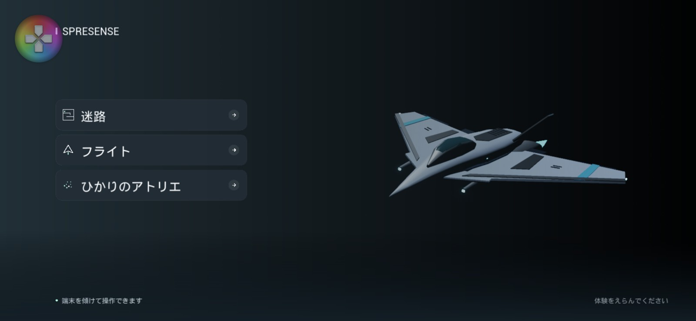
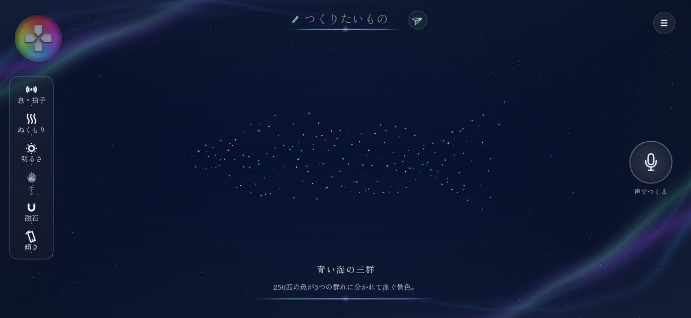
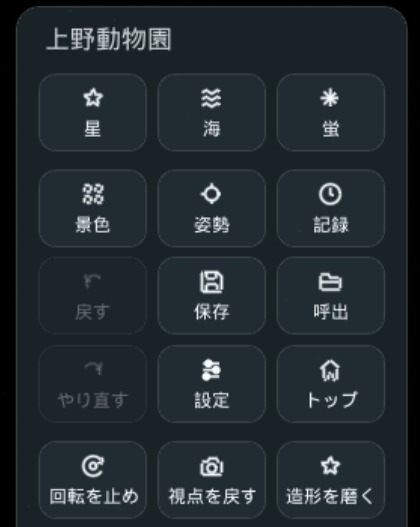
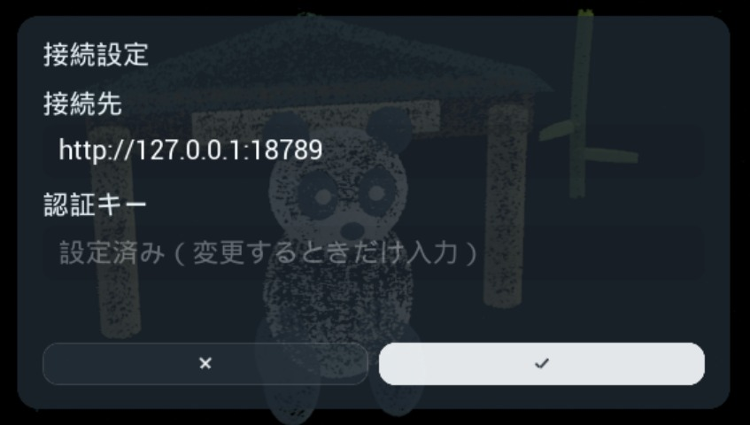

# Spresense Games

Spresenseやスマートフォンの傾きで遊ぶ、Android向けの3つの体験です。対象実機は **Xperia 1 VII** です。



## 1. インストール

[**APKをダウンロード**](https://github.com/NaitoMitsuharu/spresesneMaze/releases/download/v0.5.0-preview.5/SpresenseMaze-arm64.apk)して、Android端末で開きます。Android 14以上・arm64向けです。別のゲームデータは不要です。

PCから更新する場合は、記録を残したまま次のコマンドを実行できます。

```powershell
adb install -r -t SpresenseMaze-arm64.apk
```

> アプリ名を「Spresense Maze」から「Spresense Games」に変更し、パッケージ名も `com.lati.spresensegames` に変わりました。旧アプリ（`com.lati.spresensemaze`）とは別のアプリとしてインストールされ、旧アプリの記録・接続設定は引き継がれません。ひかりのアトリエの認証キーは、Termuxで `bash start-lightbox.sh` を実行すると新アプリへ自動で設定されます。端末内のTermux／OpenClaw／Copilotは引き続き使えます。不要になった旧アプリは手動でアンインストールしてください。

Spresenseを使う場合は、先に[ServiceアプリとUSB接続の準備](Docs/SetupAndDevelopment.md#1-端末とセンサーを準備する)を行ってください。未接続でも端末内蔵センサーで試せます。

## 2. 体験を選ぶ

トップ画面で体験を選び、選択中の項目をもう一度タップすると始まります。

| 体験 | 遊び方 |
|---|---|
| **迷路** | 傾けてボールを転がし、ゴールを目指します |
| **フライト** | 傾けて操縦し、リングを通過します。射撃は自動です |
| **ひかりのアトリエ** | 声や文字で景色を作ります。鳥や海もすべて粒子です |

## 3. 声・文字で景色を作る



- **声**：マイクを押して話します。聞き取りが終わると自動で作成します。
- **文字**：下の入力欄に書き、キーボードを閉じて **→** を押します。
- **見回す**：景色をドラッグ。2本指のピンチで拡大・縮小します。
- **待つ間**：AIの待機中は経過秒数、粒子の形成中は進捗％が出ます。**■** でAIへの依頼を取り消せます。

例えば「なすを作って」「カモメが羽ばたく夕焼けにして」「色だけを青くして」と話しかけられます。

右下には**説明・実粒子数・直近の依頼の推定cr**が残ります。描画し続けるだけではAIを呼びません。

## 4. メニューで調整する



右上の **☰** を押します。

| やりたいこと | 押す項目 |
|---|---|
| すぐ試す | **星・海・蛍**、または **景色**の見本 |
| 残す・やり直す | **保存・呼出・戻す・やり直す** |
| 持ち方や視点を合わせる | **姿勢・視点を戻す・自動回転** |
| 完成した形を改善する | **造形を磨く**。現在の画像をAIへ送り、修正を依頼します |
| 利用量を見る・接続する | **記録・設定** |

**声・文字での生成と「造形を磨く」はAIを利用します。** 見本・カメラ操作・保存した景色の呼び出しはAIへの接続なしで使えます。

## 新規Android端末で「ひかりのアトリエ」を使う

初回だけ、同じ端末の **Termux → OpenClaw → Copilot** を準備します。

1. [初回セットアップ](Docs/SetupAndDevelopment.md#新規android端末でひかりのアトリエを使う)に沿って、ログインと端末内サービスの起動を行います。
2. `start-lightbox.sh` がアプリを開き、認証キーを自動で設定します。アプリの **☰ → 設定** で接続先 `http://127.0.0.1:18789` と「設定済み」を確認します。
3. マイクを許可し、SIMまたはWi-Fiにつないで話しかけます。



画像は設定済みの状態です。自動設定されなかったときは、認証キーを入力して **✓** で保存します。

翌日以降は、ひかりのアトリエを開くと接続を確認し、必要に応じて演出サービスを起動します。やり直す場合は **☰ → 設定 → 「接続を自動で準備する」** を押します（初回だけTermux側の許可設定が必要です。[手順](Docs/SetupAndDevelopment.md#翌日以降の起動と困ったとき)）。Termuxから起動する場合は次を実行します。

```bash
cd ~/lightbox
bash start-lightbox.sh
```

## 粒子数について

標準は **131,072粒**、設定できる上限は **100万粒**です。「粒数だけ10万にして」のように指定できます。
少ない粒数を指定した場合、AIが疎らな表現を選んだ場合、以前に保存した景色を呼び出した場合は、標準より少ない粒数でも表示します。保存済みの粒数は変更しません。
物体を増やすだけで粒数を自動加算する仕組みではありません。
ホタルなど少数で描く景色もあり、減らす途中は消える前の粒も表示数に含みます。100万粒は動作が重くなるため、通常は標準値から試してください。

## 詳しく知りたいとき

- [初回セットアップ・トラブル対処・開発手順](Docs/SetupAndDevelopment.md)
- [粒子の移動・進捗表示・造形の改善と実機映像](Docs/ParticleExperience.md)
- [操作できること・指示の例](Docs/LightBoxScene.md)
